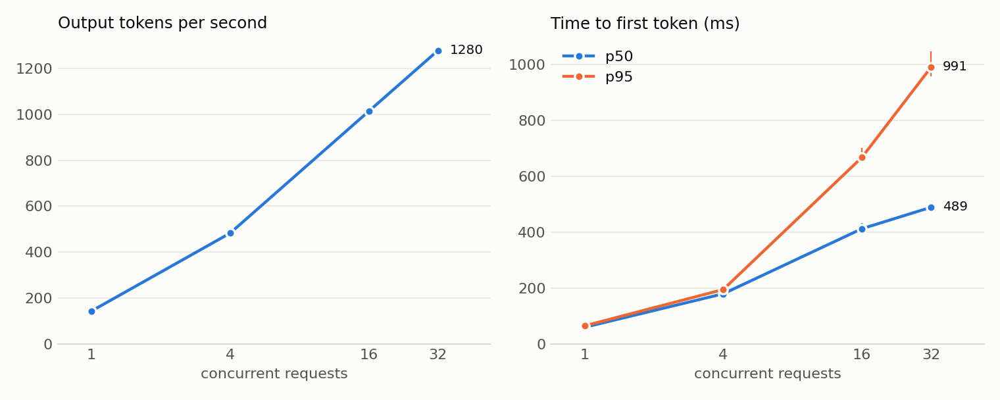

# rag-golden-serve

The question-answering pipeline of [rag-golden-eval](https://github.com/CY-HYUN/rag-golden-eval), turned into a service
that is served, observed and deployed. The retriever and the golden set come from that repository at a pinned commit,
so the evaluation set that measured the pipeline is also the check that gates each change to the service.

Every stage ends with one measured line and the command that reproduces it. A stage with no number is not done.

## Status

**Stages 1 and 3b are measured** (2026-11-21). The code of stages 2, 3a and 3c is in the repository (service, observability
stack, chart, Terraform, CI); a stage gets its row filled only when its number has been measured. Stage 0
(environment) is recorded in [docs/stage0-environment.md](docs/stage0-environment.md).

| stage | what it shows | result | reproduce |
|---|---|---|---|
| 1. serving | an open model behind vLLM on a Colab T4: time to first token and output tokens/s at concurrency 1 to 32, three repeats | Qwen2.5-0.5B-Instruct, 512 tokens in and 128 out: 143 output tokens/s at 1 concurrent request, 1,280 at 32; TTFT p95 64 ms and 991 ms; throughput within 1% over three repeats ([details](docs/stage1-serving.md)) | `bench/colab_vllm_t4.ipynb`, then `bench/extract_results.py` and `bench/summarize.py` |
| 2. observability | Prometheus, Grafana and OpenTelemetry on the service: latency per stage, and an alert seen both silent and firing | - | - |
| 3a. Kubernetes and Helm | a local cluster (kind): one rollout of a new version and one rollback | - | - |
| 3b. CI | the retrieval check on every pull request: a pull request with broken retrieval is blocked before merge | a pull request that kept one chunk per paper passed the unit tests and the cluster install, dropped recall@5 from 91/119 to 48/119 (0.765 to 0.403) and was refused by the required check; a second pull request passed and was merged ([details](docs/stage3b-ci.md)) | `uv run pytest -q -s tests/test_retrieval_gate.py`; the two pull requests |
| 3c. Terraform | cluster and namespace created and destroyed from code | - | - |



## Design in short

- **Service.** `POST /ask`: BM25 retrieval over the rag-golden-eval corpus, then generation through an
  OpenAI-compatible endpoint. If the model server is down, `/ask` answers 502, so the error-rate alert can see it.
- **Two environments, never mixed.** Serving numbers are measured on a GPU (Colab T4, benchmark client and server
  in the same notebook). The deployed stack runs on a laptop and talks only to a local CPU server with the same API.
- **The retrieval gate.** recall@5 on the 119 answerable questions of the golden set, computed through the same
  function `/ask` uses, must stay at or above 0.7647 (91 of 119), the BM25 value committed in rag-golden-eval's
  `results/summary.json`. BM25 is deterministic at fixed library versions, so the rule is exact.
- **Who owns what.** Terraform owns the cluster and the namespace. Helm owns the release and its rollback.
- **Out of scope.** Answer-quality scoring with a judge model, retrieval improvements, cloud deployment, GPUs on
  Kubernetes, autoscaling, a front end.

The full reasoning, the options that were rejected and the stop line of each stage are in [docs/design.md](docs/design.md).

## Layout

```
src/rag_golden_serve/   the service: /ask, /healthz, /metrics
vendor/rag-golden-eval/ the evaluation repository, a git submodule at a pinned commit (clone with --recurse-submodules)
tests/                  unit tests with a fake model, the retrieval gate, the stub model server CI deploys
bench/                  stage 1 (Colab notebook, table and figure scripts) and the result files of every stage
observability/          Prometheus, the alert rule and its unit tests, Grafana, OpenTelemetry Collector
compose.yaml            the local stack: service, CPU model server, Prometheus, Grafana, collector
scripts/                the alert drill, the prompt comparison, the local deploy
deploy/helm/            the chart, and the values CI uses
deploy/terraform/       cluster and namespace, two roots applied one after the other
docs/                   design, the environment record, one page per finished stage
```

Paths are relative to the repository root or come from environment variables. `.env.example` lists the variables;
`.env` is never committed.

## License

MIT
