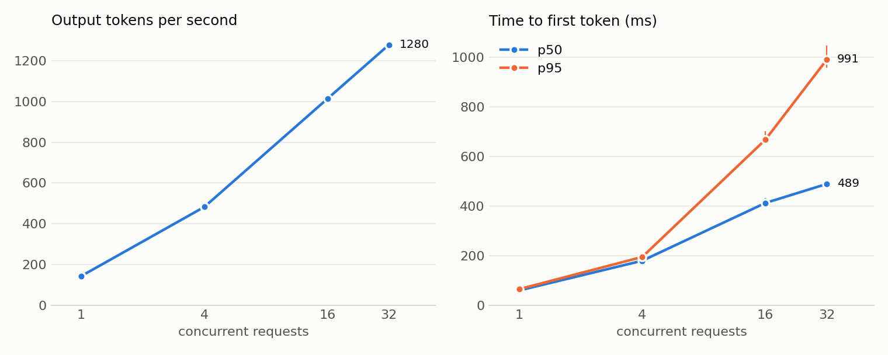

# Stage 1: serving on a Colab T4

Measured 2026-11-21 in one free Colab session. Everything below comes from the files in
[`bench/results/2026-11-21_colab-t4/`](../bench/results/2026-11-21_colab-t4/).

## What was run

| | |
|---|---|
| model | Qwen/Qwen2.5-0.5B-Instruct, `vllm serve --dtype half --max-model-len 4096`, no other setting |
| machine | Tesla T4 (15,360 MiB, driver 580.82.07), 2 vCPUs (Xeon 2.00 GHz), 12 GB RAM |
| software | vLLM 0.34.0, torch 2.14.0, transformers 5.22.1, Python 3.13.16 |
| load | `vllm bench serve`, completions endpoint, random dataset: 512 input tokens, 128 output tokens (`--ignore-eos`) |
| per run | 256 requests at a fixed concurrency (1, 4, 16, 32), a new seed per run |
| repeats | 3 passes over the four levels, after one discarded warm-up run (64 requests) |

The load generator ran on the same machine as the server, as the design requires.

## Result

Median of 3 repeats, with the lowest and highest repeat in brackets.

| concurrency | output tokens/s | TTFT p50 (ms) | TTFT p95 (ms) |
|---|---|---|---|
| 1 | 143 (143 to 144) | 59 (59 to 60) | 64 (64 to 64) |
| 4 | 483 (482 to 483) | 179 (177 to 179) | 194 (194 to 202) |
| 16 | 1014 (1011 to 1018) | 412 (402 to 432) | 667 (653 to 702) |
| 32 | 1280 (1273 to 1281) | 489 (471 to 496) | 991 (958 to 1048) |



Reading it: batching concurrent requests raises output from 143 to 1,280 tokens per second (about 9 times) between
1 and 32 concurrent requests, and the price is the wait for the first token: its p95 goes from 64 ms to 991 ms. The
gain per doubling is already small between 16 and 32 (1,014 to 1,280) while TTFT p95 grows by half.

Spread of the repeats: throughput moved by less than 1% at every level. TTFT p95 moved most at 32 concurrent
requests (958 to 1,048 ms), so a difference under about 10% there is inside the noise of this setup.

## Checks on the numbers

- **No failed request.** All 12 measured runs completed 256 of 256; `summarize.py` refuses a run that did not.
- **Lengths were fixed.** Every run reports 131,072 input tokens (256 x 512) and 32,768 output tokens (256 x 128).
- **Client against server.** The benchmark's mean TTFT over all 3,136 requests (warm-up included) is 279 ms; the
  server's own `vllm:time_to_first_token_seconds` counters give 266 ms over the same 3,136 requests. The client sees
  13 ms more, which is the HTTP path the server does not count.
- **No prefix-cache help.** Each run uses its own seed, so no prompt is sent twice.

## Limits

- One session on one T4. Another session can land on a different host; the spread above is within a session only.
- The benchmark client shares the 2 vCPUs with the server. At 32 concurrent requests part of the flattening may be
  the client and the HTTP server rather than the GPU. This run cannot separate them.
- Random tokens on the completions endpoint measure the engine, not a chat workload with a template and real text.
- TTFT p95 over 256 requests rests on the 13 slowest.
- `--dtype half` was set from the start; starting without it on the T4 was not tried.
- The result files carry a `max_concurrent_requests` field about twice the concurrency that was set. Throughput and
  inter-token latency match the set concurrency (4 streams at 6.9 ms per token give the measured 483 tokens/s once
  the first-token wait is counted), so the field is not used here; what it counts was not looked up.
- Nothing was tuned and no quantised variant was compared. That is the stop line of this stage.

## Reproduce

1. Open [`bench/colab_vllm_t4.ipynb`](../bench/colab_vllm_t4.ipynb) in Colab with a T4 runtime and run the cells
   top to bottom (about 5 minutes of install and start-up, 20 minutes of load). Save the notebook with its outputs.
2. Split the saved notebook into result files and build the table and the figure:

```
python bench/extract_results.py <saved notebook>.ipynb bench/results/<date>_colab-t4
python bench/summarize.py bench/results/<date>_colab-t4
```

The notebook as it ran on 2026-11-21 is kept as `executed.ipynb` in the result folder. It has three cells the clean
notebook does not: one that lists the benchmark's flags (`--help=all`; plain `--help` prints only group names in
this vLLM version), one that reprints the results without the per-request arrays, and one that prints the CPU, memory
and torch version.
