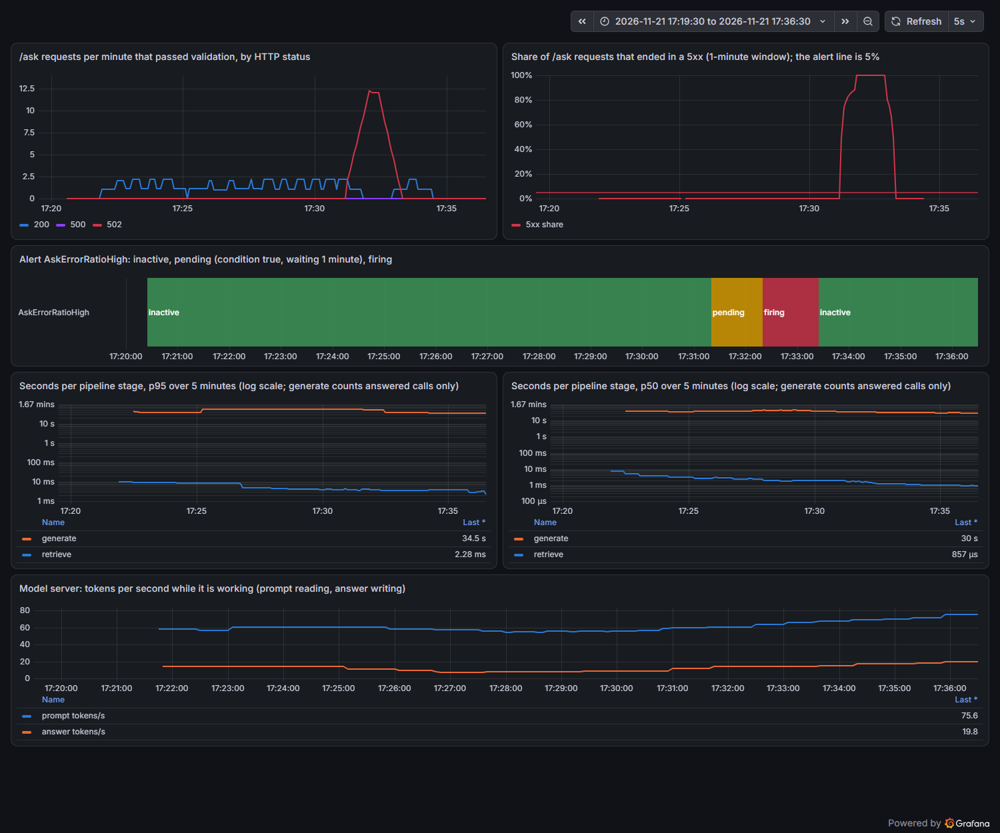

# Stage 2: the service observed, and one alert seen silent and firing

Run 2026-11-21 on the laptop of stage 0, with the stack of [`compose.yaml`](../compose.yaml): the service, llama.cpp's
server with Qwen2.5-0.5B-Instruct (Q4_K_M) on the CPU, Prometheus 3.16.0, Grafana 13.3.1 and an OpenTelemetry
Collector 0.165.0. The files behind the numbers are in
[`bench/results/2026-11-21_alert-drill/`](../bench/results/2026-11-21_alert-drill/).

## What is observed

| signal | where it comes from | what it answers |
|---|---|---|
| `rag_requests_total{status}` | a counter in `/ask`, exported at 0 for 200, 500 and 502 from the start | how many requests, and how many failed |
| `rag_stage_seconds{stage}` | a histogram around retrieval and around the model call (answered calls only) | where the time of a request goes |
| three spans per request | OpenTelemetry: the HTTP request, `retrieve`, `generate`, sent to the collector | one request, step by step, with the chunk ids and the token counts |
| `llamacpp:*` | the model server's own `/metrics` | tokens per second while it works |
| alert `AskErrorRatioHigh` | [`observability/alerts.yml`](../observability/alerts.yml): 5xx share of the last minute above 5%, for one minute | is the service failing right now |

`/healthz` does not call the model server on purpose: when the model server is down `/ask` answers 502, the alert
fires, and the service itself stays up, so the failure stays visible in the numbers instead of becoming a restart loop.

## The drill

`scripts/alert_drill.py` sends golden-set questions one after another, stops the model server after ten minutes,
waits for the alert, starts the model server again. Every request and every change of the alert's state is written
with its UTC time.

| time (UTC) | event | seconds after the stop |
|---|---|---|
| 16:21:05 | traffic starts; alert `inactive` | |
| 16:21:05 to 16:31:12 | 15 requests answered (30 to 57 s each, median 37 s); alert `inactive` throughout | |
| 16:31:12 | `docker compose stop model`; the request in flight fails after 19 s, the next 15 fail in about 25 ms each | 0 |
| 16:31:22 | alert `pending` | 10 |
| 16:32:22 | alert `firing` | 70 |
| 16:32:23 | `docker compose start model` | |
| 16:32:56 | first answer after the restart | |
| 16:33:27 | alert `inactive` | 64 s after the restart |



Reading the dashboard (its clock is local time, one hour ahead of UTC): the blue line is answered requests, about
1.5 a minute; when the model server stops the red line takes over and the 5xx share jumps from 0 to 100%; the alert
row goes green, yellow for one minute, red, green. Per stage, retrieval takes about 2 ms (p50 2.1 ms, p95 6.2 ms) and
generation about 37 s (p50 37.0 s, p95 56.5 s, from the histogram over the ten healthy minutes): the request is the
model call. The last panel says why: the server reads the prompt at 55 to 75 tokens per second, and a prompt with five
passages is about 2,000 tokens (2,184 in the trace below).

One answered request, as the collector received it:

```
POST /ask   37.596 s   http.status_code 200
  retrieve   0.003 s   rag.chunk_ids ["2607.03551#29", "2607.03551#6", ...]
  generate  37.586 s   gen_ai.request.model qwen2.5-0.5b-instruct, rag.prompt_version v1,
                       gen_ai.usage.input_tokens 2184, gen_ai.usage.output_tokens 25, rag.abstained false
```

and one while the model server was down: `POST /ask` 0.027 s with status 502 and span status `Error`, `generate`
0.023 s with the exception recorded.

## What differs from the design

The stop line asked for "100 requests in 10 minutes" of healthy traffic. This CPU answers one request in 30 to 57
seconds, so ten minutes hold 15. The number was a guess made before the first request was timed; the drill keeps the
ten minutes and reports the 15.

## Checks

- **The alert was seen in both states**, in the drill above and in the rule's unit tests
  ([`observability/alerts_test.yml`](../observability/alerts_test.yml), run by promtool in CI): healthy traffic, no
  traffic, a steady 1% of failures (no alert), a steady 10% (alert), and an outage (pending, then firing after a
  minute). Copies of the rule with the threshold moved to 200% and to 0.5% both failed those tests, so the tests
  hold the 5% line from both sides.
- **The first failure counts.** The counter exports its 500 and 502 series at 0 from the start. Without that, a rate
  cannot see the step from "no series" to 1, and the first failure after every start is invisible.
- **A failed call is not a latency.** The generation histogram takes answered calls only; otherwise an outage shows
  as generation getting a thousand times faster.
- **The recovery line needs the request file.** The alert returns to `inactive` by itself once the last failure
  leaves the one-minute window. That the service answered again is the 16:32:56 row, not the alert.

## Limits

- One drill, on one laptop, with other programs running on it; the 30 to 57 s per answer moved with them.
- At 1.5 requests a minute a one-minute window holds one or two requests, so the share is coarse. The rule also has
  a blind spot stated in its file: if every call waits out the 120-second timeout of a hung model server, failures
  arrive less than once a minute, the share keeps losing its value, and the alert does not reach `firing`. A model
  server that refuses connections, as here, fails fast and is caught.
- No Alertmanager: the rule's state is read from Prometheus, nobody is notified.
- The spans are printed by the collector, not stored; there is no trace search.
- Requests rejected by validation (422) are not counted by the request counter.

## Reproduce

```
docker compose up -d --build
python3 scripts/alert_drill.py bench/results/<date>_alert-drill        # about 13 minutes
```

The dashboard is at `localhost:3000/d/rag-golden-serve` while the stack runs.
